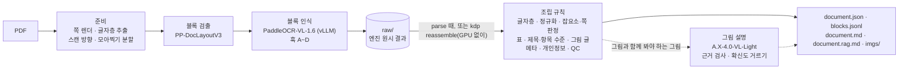
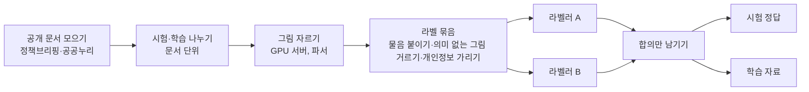

# kor_doc_parser

**한국어 공공 문서 PDF를 RAG(검색 증강 생성)용 정형 데이터로 바꾸는 문서 파서**

공문서·보도자료·보고서 같은 한국어 PDF에서 머리말·쪽번호·로고 같은 잡요소를 걸러 내고, 표·제목·항목 계층·그림 속 글자까지 구조를 살려 검색에 바로 쓸 수 있는 JSON·JSONL·마크다운으로 바꿉니다. 오픈소스 문서 인식 모델 [PaddleOCR-VL-1.6](https://huggingface.co/PaddlePaddle/PaddleOCR-VL-1.6)을 **추가 학습 없이** 그대로 쓰고, 그 위에 한국어 문서에 맞춘 규칙과 PDF 글자층(PDF 안에 글자 정보로 들어 있는 텍스트 레이어)을 더해 품질을 올렸습니다. 그림에는 국내 시각 언어 모델(SK텔레콤 A.X-4.0-VL-Light)이 설명을 붙이고, 이 모델이 약한 그림 해석은 직접 만든 학습 자료로 LoRA 튜닝하고 있습니다. 명령 이름과 결과표의 `kdp` 가 이 파서입니다.

## 한눈에 보기

| | |
|---|---|
| 기간·인원 | 2026-10-12 ~ 진행 중 · 1인 |
| 한 일 | 모델 조사·선정, 파서 설계·구현, 평가 설계(고정 정답·비교군), 클라우드 GPU 운영, 그림 해석 학습 자료 구축(합성 그림 + 라벨링)과 LoRA 튜닝 |
| 기술 | Python 3.12 · PaddleOCR-VL-1.6 · PP-DocLayoutV3 · vLLM 0.31 · pypdfium2 · pydantic · typer · transformers 5.16 · peft(LoRA) · matplotlib · NVIDIA A40 |
| 원칙 | 무료·오픈소스 모델만(조건이 붙는 라이선스 배제) · 고정 정답과 비교군으로 판정 · 개인정보는 지우지 않고 표시 · 클라우드에는 공개 문서만 |

## 이 프로젝트의 포인트

- **측정으로 판단합니다** — 개선은 모두 고정 정답과 비교군 셋(텍스트 레이어 · docling · 같은 모델의 기본 설정)을 같은 지표로 나란히 재서 판정했습니다. 규칙을 만들 때 보지 않은 문서로 다시 재고, 문턱은 개발 자료에서만 골라 확인 자료에 그대로 댑니다.
- **학습 전에 규칙과 설정으로** — PDF 글자층, PaddleX 내부 훅 4개, 한국어 문서 규칙만으로, 처음 잰 뒤 찾은 문제를 고쳐 다시 재니 13쪽 기상청 보도자료(test3)의 모든 지표에서 비교군과 같거나 앞섰습니다.
- **안 되는 것은 기록하고 방향을 바꿉니다** — 그림 설명의 틀린 문장을 27% 에서 10~16% 로 줄였지만, 그림 해석 문장도 함께 빠졌습니다. 모델을 그대로 두고 살리는 두 길(확신도 다시 재기·물음 꼴로 묻기)을 미리 정한 기준으로 시험해 둘 다 통과하지 못함을 확인하고, 지도 학습(LoRA)으로 넘어갔습니다.
- **학습 자료를 직접 만들었습니다** — 정답을 코드가 계산하는 합성 그림 3,000장과, 공개 정부 문서 33개의 실제 그림을 Claude 라벨러 에이전트 둘이 따로 매겨 합의한 정답 745개(정답 다툼 0, 사람 확인 전)를 만들었습니다.
- **운영까지 자동화했습니다** — 켤 때마다 초기화되는 클라우드 GPU 에 환경 설치·모델 서빙·학습·평가를 스크립트로 묶어, 설치 7~10분 뒤 학습과 평가를 한 번에 돌립니다.

## 핵심 성과

| 항목 | 결과 (괄호는 docling, 같은 모델 기본 설정) |
|---|---|
| 구조 정확도 | 두 문서 합계 표 머리행(헤더 행) **16/16**(9/16, 2/16), 제목 찾음 **29/30**(27/30, 15/30), 항목 수준 **41/41**(34/41, 0/41) |
| 잡요소 제거 | 두 문서의 머리 줄·로고·쪽번호 **50/50** 을 모두 거름(24/50, 47/50) |
| 본문 보존 | 본문 글자 조각 **1,031/1,032** 이 출력에 남음(1,021, 1,010 — 텍스트 레이어는 1,032) |
| 그림·그래프 | 그림 제목 연결 **12/12**(7/12, 0/12), 그래프·지도 속 글자 **81/136** 줄 읽음(비교군은 이 글을 내지 않음. 읽은 줄의 약 13%는 정답에 없는 줄) |
| 그림 설명 | 국내 시각 언어 모델 셋을 견줘 A.X 를 고르고, 틀린 문장을 **27% → 10~16%** 로 줄임(처음 보는 문서 둘에서도 12%) |
| 그림 해석 학습 자료 | 합성 그림 **3,000장**(물음 8,532) + 실제 공개 문서 그림의 합의 정답 **745개**(학습 605 · 시험 140, 정답 다툼 0) |
| 그림 해석 튜닝 | LoRA 1 에폭(A40 2시간 55분)으로 실제 문서 그래프 해석 정답률 **57% → 81%**(물음 167개). 지도 방위는 19% 그대로이고, 미리 정한 통과 기준은 넘지 못함 |
| 속도 | A40 GPU + vLLM 에서 쪽당 **1.9~2.9초**(문서 하나씩, 파서 쪽 검출 모델 불러오기 포함 — vLLM 서버는 미리 띄워 둠) |
| 검증 | 자동 시험 **623개 통과**, 독립 검토·재검토에서 확인된 지적 **207건** 반영(고치지 않은 것은 한계로 기록) |

> 공개 정부 문서 2건(21쪽)을 비교군 셋과 **같은 정답, 같은 지표**로 쟀습니다. 두 문서 모두 처음 잰 뒤 찾은 문제를 고쳐 다시 잰 값입니다([한계](#한계와-다음-단계) 참고). 처리 시간은 장비가 달라 비교군과 견주지 않았습니다.

## 왜 만들었나

RAG 의 첫 단계는 문서에서 검색에 쓸 글을 뽑는 일입니다. 한국어 공문서·보고서 PDF에는 이 단계를 어렵게 하는 것이 많습니다.

- 모든 쪽에 되풀이되는 머리말·꼬리말·쪽번호·로고, 표지·목차 — 그대로 넣으면 검색 결과가 오염됩니다.
- 병합 머리글·대각선 칸이 있는 표, 표와 따로 떨어진 표 제목·단위·출처 줄
- 개조식(□ → ○ → -) 계층과 '붙임 1 …' 같은 문서 구조
- 그림·그래프·지도 안에만 있는 글자와, 그림을 봐야만 아는 뜻(어디가 가장 높은지·언제 늘었는지)
- 담당자 연락처 같은 개인정보

일반 문서 파서는 이런 한국어 문서 구조를 자주 놓쳤습니다(아래 결과표). 그래서 다음 조건으로 직접 만들었습니다.

- **무료·오픈소스만** — 유료 API, 상업 이용에 조건이 붙는 라이선스는 쓰지 않습니다(GPU 에 필요한 NVIDIA CUDA 는 독점이지만 무료라 예외).
- **한국어 우선, 가벼운 모델(약 1B)** 로 품질과 속도·비용의 균형을 맞춥니다.
- **모델을 학습시키기 전에 규칙·설정만으로 품질을 최대한** 올리고, 고정 정답과 비교군으로 개선 여부를 판정합니다.

## 동작 방식



- **준비** — pypdfium2 로 쪽을 렌더하고 PDF 글자층을 뽑습니다. PDF 에서 그리지 않는 글자와 흰 글자·가림 상자에 가려진 글자는 빼서, 가린 개인정보가 되살아나지 않게 합니다. 글자층이 없는 스캔 쪽은 방향 모델이 확신할 때만 똑바로 세우고, 한 장에 여러 쪽을 모아 찍은 시트(2×1·1×2·2×2)는 나눠서 다시 렌더합니다.
- **엔진** — PP-DocLayoutV3 가 블록(글·제목·표·그림·머리말·쪽번호 등 25종)을 찾고, PaddleOCR-VL-1.6(그림을 보고 글을 쓰는 시각 언어 모델, VLM — GPU 에서는 추론 서버 vLLM 으로 띄웁니다)이 블록마다 글자·표를 읽습니다. 설치된 PaddleX 파이프라인의 내부 메서드를 감싸는 훅(hook) 네 개로 동작을 고칩니다. 내부 메서드에 기대므로 PaddleX 3.7.2 로 버전을 고정하고 계약 시험으로 지킵니다.
  - **A** 응답마다 생성 종료 사유·토큰 수를 남기고, 블록 하나의 오류는 그 블록만 오류로 격리합니다(vLLM 서버로 돌릴 때).
  - **B** 블록별 모델 원문, 잘림(길이 한도·되풀이), 병합 관계를 기록합니다.
  - **C** PDF 글자층으로 채울 수 있는 글 블록과 로고는 VLM 에 보내지 않습니다(쪽마다 검증 표본 3개는 보냅니다).
  - **D** 그래프·지도도 '보이는 글자 그대로' 읽게 합니다. 값을 지어내던 그래프 → 표 변환은 껐습니다.
- **조립** — 원시 결과에 한국어 문서 규칙을 적용합니다: 글자층 적용·정규화 → 잡요소·공문 메타·결재란·쪽 종류 판정(표지·목차·빈 쪽·간지·결재 쪽·미기입 서식) → 표(머리행·제목·단위·출처 연결, 쪽 넘김 표 잇기) → 제목 수준·섹션 경로·항목 수준 → 그림 감싼 문단·쪽 넘김 문단 잇기 → 문서 메타 승격·개인정보 표시 → 품질 점검(QC).
- **그림 갈래와 그림 설명** — 그림 속 글자만 꺼내면 뜻이 깨지는 그림이 많습니다(기온 지도의 '23.1 · 18.4' 는 어디가 더운지 알려 주지 않습니다). 그래서 그림마다 '글자만으로 뜻이 서는 그림'과 '그림과 함께 봐야 하는 그림'을 가르고, 그림 파일·그림 제목·그림 속 글자를 한 블록으로 묶어 냅니다. 뒤의 그림에는 A.X 가 앞뒤 본문과 이어지는 설명 문장을 붙입니다(기본 켬). 값·지명이 그림·문맥에 없는 문장, 적히지 않은 날짜나 자료 기간 밖의 때, 범례 눈금을 값의 범위로 쓴 문장, 본문을 옮겨 적은 문장, 모델이 확신하지 못한 문장은 뺍니다.
- **지우지 않고 표시** — 잡요소는 `keep: false` 와 이유(`drop_reason`)를 달아 남기고, 규칙이 바꾼 것은 `provenance` 에 기록합니다. 검수와 원인 찾기가 쉽습니다.
- **GPU 없이 다시 조립** — 엔진 원시 결과를 `raw/` 에 남겨, 규칙을 고친 뒤 `kdp reassemble` 로 모델을 다시 돌리지 않고(GPU·원본 PDF 없이) 다시 만듭니다. `parse` 와 `reassemble` 의 출력이 바이트까지 같은지 통합 시험으로 확인합니다.

## 주요 설계 결정

결정 20개(D1~D20)의 근거와 버린 선택지는 [`기획서.md`](기획서.md)에 있습니다. 그 가운데 결과를 크게 가른 것들입니다.

| 결정 | 고른 것 | 까닭 |
|---|---|---|
| 인식 모델 | PaddleOCR-VL-1.6(0.96B, Apache-2.0) 기본 가중치 | 라이선스·한국어 성능·크기로 견준 다섯 기준(MDPBench 한국어 86.3 등) 어디에서도 탈락 사유가 없었고, 함께 쓰는 검출기가 머리말·쪽번호·로고를 따로 라벨로 내 잡요소 거르기에 맞았습니다. AGPL 이중 라이선스(PyMuPDF 등)·사용 규모 조건(MinerU)·자체 약관 모델은 뺐습니다 |
| 글자 출처 | 글자층이 있는 쪽은 PDF 글자층을 먼저 쓰고, VLM 은 검증 표본과 나머지 블록에만 | 글자 오류가 없고 빠릅니다. 깨진 글자층은 막고, 흰 글자·가림 상자 아래 글자는 빼서 가린 개인정보가 되살아나지 않습니다 |
| 엔진 고치기 | 모델은 그대로, PaddleX 내부 메서드에 훅 4개(PaddleX 3.7.2 고정 + 계약 시험) | 블록 오류 격리·잘림 기록·VLM 생략·그래프 글자 읽기를 학습 없이 넣었습니다 |
| 출력 | 지우지 않고 표시, 엔진 원시 결과(`raw/`) 보관 | 검수·원인 찾기가 쉽고, 규칙을 고친 뒤 GPU 없이 다시 만듭니다 |
| 그래프 | 표로 바꾸지 않고 보이는 글자 그대로 | 그래프 → 표 변환이 그림에 없는 값을 지어내서 껐습니다 |
| 그림 설명 | 국내 무료 VLM(A.X-4.0-VL-Light) + 근거 검사 + 토큰 확신도 거르기 | 디노티시아 DNA3.0 2B·4B·9B 와 견줘 가장 정확했고, 틀린 문장을 규칙과 확신도로 줄였습니다 |
| 그림 해석 | 지도 학습(LoRA) — 합성 그림 + 실제 그림(독립 라벨러 둘 합의) | 비지도·반지도·자기 지도·강화 학습과 견줬습니다. 정답을 코드가 계산하는 합성 그림으로 양을, 실제 문서 그림으로 실제 모양을 채웁니다. 강화 학습(GRPO)은 지도 학습으로 기본기를 만든 뒤의 후보로 남겼습니다 |

## 결과

### test3.pdf — 기상청 보도자료, 13쪽

| 지표 | 텍스트 레이어 | docling | PaddleOCR-VL 기본 | **kdp** |
|---|---|---|---|---|
| 본문 글자 조각이 출력에 있음 | 868/868 | 865/868 | 855/868 | **868/868** |
| 잡요소 제거(머리 줄·로고·쪽번호) | 0/21 | 14/21 | 19/21 | **21/21** |
| 표 검출 · 행열 일치 | 0/13 · 0/13 | 13/13 · 9/13 | 13/13 · 12/13 | **13/13 · 12/13** |
| 표 머리행 일치 | 0/13 | 7/13 | 1/13 | **13/13** |
| 표 제목 연결 | 0/13 | 10/13 | 7/13 | **13/13** |
| 그림 찾음 · 그림 제목 연결 | 0/8 · 0/7 | 8/8 · 7/7 | 8/8 · 0/7 | **8/8 · 7/7** |
| 그래프·사진·지도 글자가 본문에 섞임(글자 수, 낮을수록 좋음) | 0 | 6 | 65 | **0** |
| 그래프·지도 속 글자 읽음 | 0/79 | 0/79 | 0/79 | **40/79** |
| 제목 찾음 · 수준 일치 | 0/15 · — | 13/15 · 8/13 | 4/15 · 2/4 | **15/15 · 15/15** |
| 항목 수준 일치 | 0/20 | 15/20 | 0/20 | **20/20** |
| 출력 잡문자(낮을수록 좋음) | 0 | 0 | 24 | **0** |

<details>
<summary>test2.pdf — 질병관리청 보도참고자료, 8쪽 (표 펼치기)</summary>

| 지표 | 텍스트 레이어 | docling | PaddleOCR-VL 기본 | **kdp** |
|---|---|---|---|---|
| 본문 글자 조각이 출력에 있음 | **164/164** | 156/164 | 155/164 | 163/164 |
| 잡요소 제거(머리 줄·로고·쪽번호) | 0/29 | 10/29 | 28/29 | **29/29** |
| 표 검출 · 행열 일치 | 0/3 · 0/3 | 3/3 · 2/3 | 3/3 · 3/3 | **3/3 · 3/3** |
| 표 머리행 · 제목 연결 | 0/3 · 0/3 | 2/3 · 1/3 | 1/3 · 1/3 | **3/3 · 3/3** |
| 그림 찾음 · 그림 제목 연결 | 0/8 · 0/5 | 4/8 · 0/5 | 6/8 · 0/5 | **6/8 · 5/5** |
| 그래프·사진·지도 글자가 본문에 섞임(글자 수, 낮을수록 좋음) | 0 | 0 | 2 | 2 |
| 그래프·지도 속 글자 읽음 | 0/57 | 0/57 | 0/57 | **41/57** |
| 포스터 그림 속 글자 줄 | 0/60 | 0/60 | **55/60** | 53/60 |
| 제목 찾음 · 수준 일치 | 0/15 · — | 14/15 · 5/14 | 11/15 · 2/11 | **14/15 · 14/14** |
| 항목 수준 일치 | 0/21 | 19/21 | 0/21 | **21/21** |
| 출력 잡문자(낮을수록 좋음) | 0 | 0 | 5 | **0** |

</details>

- **비교군**: 텍스트 레이어는 PDF 글자만 뽑는 가장 단순한 기준(바닥선)입니다(글자는 정답과 같지만 구조가 없습니다). docling 2.138 은 일반 문서 파서(OCR 끔)이고, PaddleOCR-VL 기본은 같은 모델을 설치된 기본 설정 그대로 돌린 것이라 차이는 주로 우리 규칙·훅이 더한 몫입니다. 다만 비교군은 개발용 CPU 에서, kdp 는 GPU(vLLM)에서 돌려 모델 출력이 조금 다를 수 있습니다.
- **지표 풀이**: 본문 글자 조각 = PDF 글자층을 줄·표 칸 경계에서 끊은 4자 이상 조각이 출력 본문에 있는 비율(10자당 1자 오차 허용). 잡요소 제거 = 정답의 머리 줄·로고·쪽번호 자리를 출력 본문 블록이 덮지 않은 비율. 항목 수준 = 개조식 항목(□·○·-)의 단계가 정답과 같은 비율. 출력 잡문자 = 본문에 글자 그대로 남은 `\n`·LaTeX 조각 수.
- test2 에서 kdp 가 가장 좋지 않은 줄은 셋입니다. 본문 글자 조각 1개는 모델이 표 머리 칸 하나를 빠뜨린 것입니다(기본 설정도 같음). 포스터 글자 줄은 실행 장비 차이로, 같은 코드로 CPU 출력을 조립하면 kdp 도 55/60 입니다. 섞인 2자는 그래프 아래 축 이름 '주차'(PDF 글자층의 글)입니다.
- 문서 정보(제목·기관·날짜)는 kdp 만 내며 두 문서 모두 2/3 입니다 — 발행 기관 이름이 로고 그림에만 있습니다.
- 처리 시간은 장비가 달라 표에 넣지 않았습니다. kdp 는 A40 GPU + vLLM 에서 쪽당 test2 2.9초·test3 1.9초(문서 하나씩, 파서 쪽 검출 모델 불러오기 포함, vLLM 서버는 미리 띄워 둔 상태)입니다.
- 지표 정의와 회차별 결과는 [`테스트_결과.md`](테스트_결과.md)에 있습니다.

### 그림 설명 — 국내 모델 비교와 정확도 고치기

test2·test3 의 설명이 달린 그림(모델마다 21~23개)을 모델별로 나눠, 설명 문장마다 그림을 직접 보고 맞는지 판정했습니다(AI 판정 에이전트). 세 모델 모두 Apache-2.0 이고, 그림 앞뒤 문맥을 함께 받습니다.

| 모델 | 문장 | 맞음 | 틀림 | '~다.' 로 맺은 문장 | 설명 시간(두 문서) |
|---|---|---|---|---|---|
| **SK텔레콤 A.X-4.0-VL-Light (7.7B)** | 60 | **57%** | 27% | 60/60 | 67초 |
| 디노티시아 DNA3.0-4B | 32 | 28% | 41% | 18/32 | 14초 |
| 디노티시아 DNA3.0-2B | 68 | 21% | 46% | 1/68 | 15초 |

- A.X 가 가장 나았지만 처음에는 범례 눈금을 실제 값처럼 쓰거나, 자료가 끝난 뒤를 말하거나, 색의 뜻을 거꾸로 읽는 오류로 문장의 27% 가 틀렸습니다.
- 그래서 물음에 오류 꼴별 쓰는 법을 넣고, 때·범위 검사(적히지 않은 날짜·주, 자료 기간 뒤의 달, 범례 눈금 범위, 전망)와 본문 옮김·문장 꼴 규칙을 더했습니다. 또 설명 모델이 낱말마다 내는 확률을 받아, 확신이 낮은 문장(문장 평균 로그확률 -0.30 아래)을 뺐습니다. 새 문장을 다시 판정한 결과는 아래와 같습니다.

| A.X | 남은 문장 | 맞음 | 틀림 | 그림을 봐야 아는 정답 사실 | 설명 붙은 정답 그림 |
|---|---|---|---|---|---|
| 처음(9장) | 60 | 57% | 27% | 10/30 | 14/14 |
| **고친 뒤(기본)** — 다시 조립 | 21 | 81% | **9.5%** | 1/30 | 10/14 |
| 고친 뒤 — 처음부터 새로 파싱 | 19 | 74% | 16% | 1/30 | 10/14 |
| 고친 뒤 — 처음 보는 문서 test4·test5 | 43 | 84% | 12% | 7/60 | 14/20 |

- 규칙을 만들 때 보지 않은 공개 문서 둘(질병관리청 온열질환 보도자료 12쪽, 대구지방기상청 기후특성 24쪽)로 다시 재도 틀린 문장은 12% 로 같았습니다. 규칙과 문턱이 개발 문서에만 맞춘 것이 아니었습니다.
- 대신 남은 설명은 대부분 그림 글자·막대 숫자·주석을 앞뒤 글과 이어지는 문장으로 옮긴 것입니다. A.X 가 그림을 해석한 문장은 맞든 틀리든 확신이 낮아 함께 빠집니다 — 다음 장의 튜닝으로 이어진 문제입니다.
- 다른 모델이 문장마다 다시 확인하는 방법(DNA3.0-9B 생각 켬)과 9B 설명도 재 봤지만 A.X + 확신도보다 낫지 않았습니다.
- A40 46GB 한 장에서 파싱과 함께 띄웁니다. PaddleOCR-VL 서버 몫을 0.5 에서 0.25 로 줄여도 파싱 속도가 같아(이제 기본 0.25), 그 자리에 설명 모델을 올리면 GPU 최대 33GB 입니다. 설명을 켜고 처음부터 파싱하면 test3 13쪽 54초·test2 8쪽 49초입니다.
- 자세한 결과는 [`테스트_결과.md`](테스트_결과.md) 9장(모델 비교)·10장(정확도 고치기)·11장(처음 보는 문서)에 있습니다.

### 개선 과정 — kdp 처음 잰 값 → 지금

| 지표 | test2 | test3 |
|---|---|---|
| 본문 글자 조각 | 159/164 → **163/164** | 864/868 → **868/868** |
| 표 머리행 일치 | 3/3 → **3/3** | 6/13 → **13/13** |
| 표 제목 · 그림 제목 연결 | 1/3 · 0/5 → **3/3 · 5/5** | 13/13 · 6/7 → **13/13 · 7/7** |
| 제목 찾음 | 10/15 → **14/15** | 6/15 → **15/15** |
| 항목 수준 일치 | 14/21 → **21/21** | 15/20 → **20/20** |
| 그래프·지도 속 글자(그래프 글자 읽기 전 → 뒤) | 4/57 → **41/57** | 10/79 → **40/79** |

공개 문서로 처음 잰 뒤 찾은 문제(머리말로 잡힌 '붙임' 제목, 원 숫자 항목, 표·그래프 위 □ 이름 줄, 두 단 머리글 등)를 규칙으로 고쳤습니다. 고친 판은 독립 검토로 회귀를 찾아 다시 고치고, GPU 서버로 옮겨 처음부터 다시 쟀습니다. 처리 시간은 개발용 CPU(쪽당 5분 남짓)에서 GPU 서버(vLLM, 쪽당 2~3초)로 옮기며 줄었지만, 장비와 설정이 함께 바뀌어 위 표에는 넣지 않았습니다.

## 그림 해석 튜닝 — A.X 지도 학습 (1차 시범)

### 왜 튜닝했나

그림 설명의 틀린 문장은 줄었지만, '어디가 가장 높은지·무엇이 가장 큰지·흐름이 어떤지' 같은 해석은 거의 빠졌습니다(그림을 봐야 아는 정답 사실 test2·test3 1/30, test4·test5 7/60). 모델을 그대로 두고 살리는 두 길을 먼저 시험했습니다. 통과 기준은 미리 정했습니다 — 확신 문턱 위 답의 정답률 90% 이상이면서 물음의 40% 이상에 답할 것. 문턱은 개발 자료(test2·test3)에서만 고르고, 확인 자료(test4·test5)에는 그대로 댑니다.

| 시도 | 결과 |
|---|---|
| 확신도를 다르게 재기(핵심 낱말 평균·최솟값 등 다섯 방법) | 지금 방식(문장 평균)보다 나은 방법이 없음 — 개발 자료에서 고른 문턱이 확인 자료에서는 틀림을 늘림, 채택 없음 |
| 물음 꼴로 따로 묻기(지도 9방위 보기, 그래프 가장 큰·작은 것, 전체 흐름 5보기) | 정답률 개발 20% · 확인 43%. 지도 방위는 마지막 보기로 쏠려 사실상 찍음 — 통과 못 함 |

A.X 는 그림을 **읽기**(글자·막대 위 숫자·축 이름)는 잘하지만 **해석**(위치·순위·흐름)은 물음 꼴로 바꿔도 믿을 만하지 않았습니다. 그래서 모델은 그대로 두고, 그 능력을 지도 학습으로 더하기로 했습니다(기획서 7.10 · D20).

### 학습 자료 만들기



| | 합성 그림 | 실제 공개 문서 그림 |
|---|---|---|
| 만든 법 | matplotlib 로 그린 그래프 1,000 · 지도 1,000 · 흐름도 500 · 조직도 500장 | 정책브리핑(korea.kr)의 공공누리 제1유형 보도자료 33개를 파서로 잘라 낸 그림 |
| 정답 | 그린 값·연결에서 **코드가 계산**(틀릴 수 없음) | Claude(Opus) 라벨러 둘이 **서로의 답을 보지 않고** 따로 매겨, 둘이 같게 본 것만 |
| 규모 | 물음 8,532(학습 8,103 · 검증 429 — 검증 그림 150장은 학습에 없음) | 학습 27개 문서 605 · 시험 6개 문서 140 |
| 역할 | 해석의 기본기(많은 정답), 지도·도식처럼 실제 문서에 적은 꼴 | 실제 문서의 모양에 익숙하게, **시험지는 실제 그림으로만** |

- **물음 열 가지** — 지도: 가장 높은·낮은 곳의 방위(9보기). 그래프: 가장 큰·작은 때나 항목(그림에 적힌 이름으로 단답), 전체 흐름(5보기). 흐름도: 처음·마지막 단계, 'X' 바로 다음 단계. 조직도: 맨 위, 'X' 바로 위. 합성·라벨·평가가 같은 물음 틀([`src/kdp/figure_qa.py`](src/kdp/figure_qa.py))을 글자까지 같게 씁니다.
- **새는 곳 막기** — 시험과 학습은 문서 단위로 나누고, 학습 묶음을 만드는 코드가 시험·평가 문서를 sha256 으로 뺍니다. 평가 문서와 같은 연속 보도도 넣지 않았습니다.
- **합의 규칙** — 보기 물음은 둘 다 **같은 보기 하나**만 적었을 때만 씁니다(정답이 여럿이면 맞는 다른 보기를 틀렸다고 가르치게 됩니다). 단답은 띄어쓰기·따옴표·물결표를 맞춘 뒤 비교하되, 숫자 덩어리를 자르는 맞춤('3주차' 와 '13주차', '1.5' 와 '15')은 막습니다.
- **거르기와 개인정보** — 로고·아이콘처럼 해석할 내용이 없는 그림은 넓이·글자 기준으로 자동으로 거르고(80개), 보도자료 끝 담당자 이름은 ○○○ 로, 전화번호는 라벨러에게 가기 전에 지웠습니다.
- **결과** — 그림 480개·물음 3,060개를 매겨 합의 정답 745개를 얻었습니다. 둘 다 맞는 물음이라 본 것 가운데 정답이 갈린 경우는 한 번도 없었고, 갈린 것은 '이 물음이 그림에 맞는가' 였습니다. 라벨러 에이전트 54개, 약 980만 토큰, 약 2시간이 들었습니다.
- 그림을 자를 때 쓴 상자(bbox)는 파서의 검출기가 자동으로 찾은 것입니다. 그림 안의 '답의 근거가 되는 곳' 에는 상자를 치지 않았는데, 모델이 내야 하는 것이 좌표가 아니고 흐름·분포처럼 상자 하나로 정해지지 않는 물음이 많기 때문입니다(까닭 여섯 가지와 대안은 [`테스트_결과.md`](테스트_결과.md) 12.4.7).

### 학습과 평가

| 항목 | 값 |
|---|---|
| 시작 가중치 | skt/A.X-4.0-VL-Light(7.7B, Apache-2.0 — SigLIP 그림 인코더 + Qwen2 계열 28층 언어 모델) |
| 방법 | LoRA — 언어 모델의 q·k·v·o·gate·up·down, rank 16 · α 32, 학습 무게 40.4M. 그림 인코더는 얼림. 손실은 답 토큰에만 |
| 자료 | 합성 ×1 + 실제 ×2 = 9,313개, 1 에폭 1,164 step(배치 8), lr 1e-4 · cosine |
| 자원 | A40 46GB 한 장, step 당 약 9초(2시간 55분), GPU 메모리 최대 20.2GB |
| 서빙 | 원래 가중치에 합치지 않고 얹어 띄움 — bf16 무게에 합치면 작은 변화가 반올림으로 사라집니다 |
| 평가 | 같은 그림 크롭·같은 물음으로 원래 A.X 와 견줌. 보기 물음은 보기 순서를 거꾸로 해 두 번 묻고 두 답이 같을 때만 답한 것으로 침 |

| 물음 묶음 | 원래 A.X | **튜닝 A.X** |
|---|---|---|
| 개발 test2·test3 (25물음) | 20% | **40%** |
| 확인 test4·test5 (42물음) | 43% | **60%** |
| 새 시험지 — 6개 기관 문서 (140물음) | 62% | **81%** |
| 합성 검증 — 학습에 쓰지 않은 합성 그림 (200물음) | — | **97.5%** |

| 물음 갈래(실제 문서 세 묶음 합계) | 원래 A.X | **튜닝 A.X** |
|---|---|---|
| 그래프 — 가장 큰·작은 것, 전체 흐름 | 96/167 (57%) | **135/167 (81%)** |
| 지도 — 가장 높은·낮은 곳의 방위 | 6/31 (19%) | 6/31 (19%) |
| 흐름도·조직도 | 8/9 | 8/9 |

- **그래프 해석은 크게 나아졌습니다.** 확신으로 맞는 답과 틀린 답을 가르는 힘(AUC)도 확인 묶음에서 0.70 → 0.91 로 좋아져, 확인·새 시험지에는 기준(정답률 90% · 답함 40%)을 넘는 문턱이 생겼습니다.
- **지도 방위는 그대로입니다.** 합성 지도는 95% 맞히는데 실제 기상·통계 지도로는 옮겨 가지 않았습니다(실제 지도 학습 자료는 11물음뿐).
- **판정은 통과 못 함입니다.** 문턱은 개발 묶음에서만 고르기로 미리 정했는데, 개발 묶음(25물음)에서는 어느 문턱에서도 정답률이 57% 를 넘지 않았습니다(지도 9물음을 빼고 그래프 16물음만 봐도 최고 67%). 결과를 본 뒤 규칙을 바꾸지는 않았고, 다음 시도(실제 지도처럼 그린 합성 지도, 강화 학습, 갈래별 판정 규칙)는 따로 정합니다.
- **잊음 검사 — 틀린 문장은 늘지 않았지만 맞는 문장은 줄었습니다.** 튜닝 A.X 로 설명을 쓰게 해 문장마다 그림과 대조하니 틀린 문장은 원래 14%(8/58) → 9%(5/54)로 기준(12% 이하)을 맞췄지만, 미리 정한 둘째 기준(맞는 문장이 줄지 않을 것)은 못 맞췄습니다(47 → 40). 원래 문장은 대부분 지난 판정, 튜닝 문장은 새 판정이라 판정자 차이도 섞여 있습니다. 그림을 봐야 아는 정답 사실은 7/90 → 8/90 으로, 그림을 봐야 아는 정답 사실은 7/90 → 8/90 으로, 물음 꼴로 배운 해석이 설명 문장으로 저절로 옮겨 가지는 않았습니다.
- 학습한 어댑터는 허깅페이스 `ohdyo/A.X-kor-image-caption`(지금은 비공개)에 모델 카드·`inference.py` 와 함께 올렸습니다. 학습·평가는 [`gpu_server/tune_t1.sh`](gpu_server/tune_t1.sh) 하나로 돌립니다(자세한 결과는 [`테스트_결과.md`](테스트_결과.md) 13장).

## 문제 해결 사례

| 문제 | 원인 | 해결 |
|---|---|---|
| vLLM 이 모든 요청을 400 으로 거절 | 파서가 블록마다 보내는 그림 전처리 옵션을 vLLM 0.31 이 기본으로 막음 | `--trust-request-mm-kwargs` 로 열고, 서버는 127.0.0.1 에만 엶 |
| 새 클라우드 서버에서 vLLM 이 뜨지 않음 | 드라이버 570(CUDA 12.8)인데 PyPI 판 vLLM·torch 는 CUDA 13 빌드, torchcodec 은 libnvrtc.so.13 을 찾음 | 설치 스크립트가 드라이버를 보고 CUDA 12.9 판 vLLM·torch 와 torchcodec CPU 판을 고름 |
| 그래프가 표로 바뀌며 값을 지어냄 | 모델의 차트 → 표 변환 | 끄고, 훅 D 로 보이는 글자만 읽게 함 — 그래프·지도 글자 4/57 → 41/57, 10/79 → 40/79 |
| 그림 설명 문장의 27% 가 틀림 | 범례 눈금을 값으로, 자료 기간 밖의 때, 색의 뜻을 거꾸로 | 오류 꼴별 지시 + 때·범위 규칙 + 토큰 확신도 거르기 → 10~16% |
| A.X 가 transformers 5.x 에서 멈춤 | 원격 코드가 4.49 기준 — 빠진 내부 함수, flash-attn 설정, 첫 단계에서 그림을 넣는 조건이 None 에서 멈춤 | 보정 셋을 서빙과 학습이 함께 쓰는 `load()` 에 둠 — 학습과 서빙의 입력이 같음 |
| 그림 물음 채점이 너그러움 | 두 평가자 정답의 합집합을 썼고, '3주차' 가 '13주차' 에 맞음 | 독립 검토로 찾아 겹치는 정답·숫자 덩어리 맞춤으로 고치고 기준선을 다시 셈(28%·52% → 20%·43%) |
| CPU 로 그림 자르기가 그림당 1~2분, 동시에 셋이면 메모리 부족 | CPU 에서 VLM 을 돌림 | '그림만' 파싱 설정을 따로 만들어 GPU 에서 33개 문서 16분 — 그 과정에서 찾은 제목 조립 버그는 재현 시험과 함께 고침 |
| 가린 개인정보가 출력에 되살아날 수 있음 | 흰 글자·가림 상자 아래 글자도 PDF 글자층에는 남음 | 그리지 않거나 가려진 글자를 글자층에서 뺌 |

## 검증 방법

| 시험 층 | 무엇을 | 모델 |
|---|---|---|
| 단위 | 좌표 변환·판정·조립 규칙·스키마·비교 지표·그림 물음 틀·합성 그림 정답·라벨 합의 — 합성 블록·합성 PDF | 없음 |
| 계약 | 설치된 PaddleX 3.7.2 내부에 거는 훅 — 가짜 VLM 서버·가짜 검출기. 버전을 올리면 여기서 먼저 깨집니다 | 없음 |
| 통합 | 실제 검출기 + 가짜 VLM 으로 전체 흐름, `parse` 와 `reassemble` 출력이 바이트까지 같은지 | 검출기만 |
| 실제 모델 | 합성 문서(공문·간지·모아찍기·누운 스캔·빈 쪽) — 버릴 글자는 없고 본문 글자는 있는지 | 있음 |

- 자동 시험은 GPU 서버에서 623개 통과입니다(2026-10-20). 건너뛴 1개는 docling 이 필요한 비교 시험이고(파서 환경에는 docling 을 깔지 않습니다), 알려진 한계 2개는 strict xfail(지금은 실패해야 맞는 시험)로 남겨 두었습니다. 실제 모델 시험 2개는 따로 돌려 통과했습니다.
- **정답**(`eval/golden/`): PDF 의 줄·그림 위치를 뽑고 쪽 그림으로 확인해 잡요소·표·그림·제목·항목의 위치·종류·개수와 포스터·그래프 속 글자 줄을 적었습니다. 정답을 만든 작업과 다른 점검 작업이 따로 점검하거나(test2) 처음부터 다시 세어(test3·그래프 글자) 맞췄습니다. 좌표·개수 위주이고 개인정보는 넣지 않았습니다.
- **비교군**: 바닥선(텍스트 레이어) · 외부 도구(docling) · 같은 모델의 기본 설정을 같은 정답·지표로 나란히 잽니다.
- **판정**: 그림 설명 문장은 AI 판정 에이전트가 그림을 직접 보고 다섯 갈래(맞음·틀림·근거 없음·문맥 옮김·모호)로 판정했고(첫 모델 비교는 모델·문서별로 나눠, 그 뒤는 어느 설정의 문장인지 가리고 섞어서), 판정과 정답은 `eval/judged/` 에 남겨 다른 방법·모델을 같은 기준으로 다시 잽니다.
- **독립 검토**: 단계마다 구현과 분리된 AI 검토 에이전트를 관점별(예: 분류·메타 / 표 머리행 / 그림·글자층)로 돌려 합성 반례로 회귀를 찾고, 다른 에이전트가 따로 재현해 사실인지 확인했습니다. 확인된 지적 207건(2단계 M2 31+17 · 3단계 M3 48+27 · test2 16+9 · 속도 2 · GPU 단계 11+19 · 그림 해석 튜닝 코드 27)을 반영하고 재현 사례를 회귀 시험으로 남겼습니다. 고치는 쪽이 득보다 실이 크거나 원래 있던 문제인 몇 건(표 칸의 영문자 앞 줄바꿈 기호, 연도만 든 첫 행 머리글 등)은 한계로 두었습니다.

## 한계와 다음 단계

**남은 한계**

- 그래프의 세로 축 이름·작은 글씨는 모델이 자주 놓치고 오독도 남습니다(그래프 글 가운데 정답에 없는 줄 11~15% — 10줄 가운데 9줄은 한두 글자 오독, 1줄은 지어낸 줄).
- 발행 기관 이름이 로고 그림에만 있으면 문서 정보에 넣지 못합니다.
- 첫 행이 연도뿐인 머리글('구분 | 2022 | 2023 …')은 머리행으로 잡지 못합니다.
- 같은 그림도 실행마다 모델 출력이 조금 달라질 수 있습니다(vLLM 묶음 처리).
- 지금 비교표의 실제 문서는 공개 문서 2건(21쪽)이고, 다른 유형은 합성 문서로 시험했습니다. 두 공개 문서 모두 처음 잰 뒤 거기서 찾은 문제를 규칙으로 고쳐 다시 잰 값입니다. 고치기 전 처음 본 상태의 test3 에서는 제목 찾음 6/15(docling 13/15)·표 머리행 6/13(docling 7/13)·그래프 글자 섞임 65자(docling 6자)처럼 docling 보다 낮은 지표도 있었습니다. 처음 보는 문서로 다시 재고 문서 종류를 넓혀야 합니다.
- 두 공개 문서는 모두 글자층이 있는 한글(HWP)→PDF 문서입니다. 글자층이 없는 실제 스캔 문서는 아직 재지 않았고 합성 문서로만 확인했습니다.
- 스캔 방향은 확신할 때만 돌립니다. 합성 스캔 300쪽에서 틀린 회전은 0 이었지만, 돌려야 할 쪽의 65%(표지·제목·간지·빈 쪽을 빼면 79%)만 세웠습니다. 모아찍기는 2×1·1×2·2×2 만 나눕니다.
- 지금 지표는 정답의 위치·개수와 글자 조각이 출력에 있는지를 봅니다. 검색(RAG) 성능과 정식 정확도(글자 오류율 CER·표 구조 TEDS)는 정답셋을 넓힌 뒤 잽니다.
- 그림 설명은 틀린 문장이 10~16% 남고(순위·여러 선 그래프의 흐름 시기·날짜 범위를 확신하며 틀림), 해석은 대부분 빠집니다. 튜닝한 모델은 물음 꼴의 그래프 해석만 나아졌고 설명 문장의 정답 사실은 그대로라, 설명에 붙이는 길(2차)이 남았습니다.
- 그림 해석의 실제 그림 정답도 사람이 아니라 Claude 라벨러 둘이 매겼습니다. 둘이 같게 본 것만 썼지만 같은 모델 계열의 버릇이 섞일 수 있어, 한쪽만 맞다고 본 물음과 무작위 20% 를 사람이 확인할 예정입니다. 실제 그림의 3분의 1(여러 계열 그래프·점 지도 등)은 지금 물음 꼴에 맞지 않아 빠졌습니다.
- 속도는 문서를 하나씩 돌린 값입니다. 여러 문서를 이어 돌릴 때의 처리량은 아직 재지 않았습니다.

**다음 단계**

- 그림 해석 튜닝 2차 — 실제 지도처럼 그린 합성 지도(행정 경계·색 띠 범례·지명)와 실제 지도 라벨을 늘리거나 강화 학습(GRPO, 합성 정답을 보상)을 시험하고, 그래프·지도를 따로 판정하는 규칙을 미리 정해 다시 잼. 통과하면 설명 파이프라인에 붙이는 두 길(물음 답을 문장으로 붙이기 / 튜닝 모델이 바로 설명)을 견줌
- 일괄 처리(처리 대장·이어서 하기·연속 실패 멈춤), QC 확장, 검수 도구(Label Studio) 연동, GPU 처리량 조정
- AI Hub 학습 데이터(무료·신청 승인제, 자체 이용정책)로 정답셋을 넓히고, 그다음 검출기·모델 미세 학습 — 국외 반출 제한 때문에 국내 장비에서

## 출력 형식

```
out/<문서 해시>/
├── document.json   # 정본 — 쪽·블록 전체(버린 블록도 이유와 함께), 문서 메타, QC
├── blocks.jsonl    # 청킹용 — 살린 블록만 한 줄에 하나
├── document.md     # 마크다운 — 표는 HTML, 그림은 이미지와 그림 속 글자·설명
├── document.rag.md # RAG 적재용 마크다운(LightRAG 등 길이로 자르는 도구) — 앵커 없음, 표·그림 제목을 앞에, 긴 표는 머리행 되풀이 행 묶음
├── imgs/           # 표·그림 크롭
└── raw/            # 엔진 원시 결과·그림 설명 응답(재조립용)
```

`blocks.jsonl` 예시(test2 5쪽, 일부 필드·글 생략):

```json
{"block_id": "p5.b07", "page_no": 5, "type": "table", "section_path": ["붙임 2 말라리아 주의보·경보 발령 기준 및 조치사항", "□ 발령기준"], "html": "<table><tr><th>구분</th><th>발령기준</th><th>범위</th><th>주체</th></tr>…", "header_rows": 1, "caption_id": "p5.b06", "img_path": "imgs/p5.b07.png"}
{"block_id": "p5.b12", "page_no": 5, "type": "text", "section_path": ["붙임 2 말라리아 주의보·경보 발령 기준 및 조치사항", "□ 발령에 따른 조치사항"], "list_level": 2, "text": "➀ 군집사례 기준: 해당 지역주민 중 추가사례 감지를 위한 …"}
```

블록마다 위치(`bbox`), 섹션 경로, 제목·항목 수준, 표 머리행과 제목·단위 연결, 그림 파일과 그림 속 글자·그림 설명, 개인정보 종류 표시(`pii`)가 붙습니다. 전체 스키마는 `kdp schema` 로 볼 수 있습니다.

## 빠른 시작

**환경** — 파서는 Python 3.10 이상(3.12 로 시험)입니다. GPU 에서는 모델을 vLLM 서버로 띄우고 파서가 그 서버를 호출합니다(`configs/env.yaml` 의 `vlm.backend: vllm-server`, 서버용 설정은 `gpu_server/env.gpu.yaml`). GPU 가 없으면 파서 안에서 모델을 바로 돌리는 `native`(저장소 기본값)로도 되지만 쪽당 5분 남짓 걸립니다.

```bash
pip install -e ".[test]"        # 파서 — paddlepaddle(CPU) 또는 paddlepaddle-gpu==3.3.1 은 장치에 맞춰 따로 설치
```

GPU 서버(시험한 장비: 클라우드 A40 46GB)에서는 `gpu_server/` 스크립트로 파서 환경과 vLLM 환경을 한 번에 설치합니다(약 7~10분). 순서·고정 버전·vLLM 옵션은 [`gpu_server/README.md`](gpu_server/README.md)에 있습니다.

**설정** — `configs/env.yaml` 은 머신마다 다른 값(장치, VLM 서버 주소·모델 이름, 가중치 경로, 출력 폴더)이고, `configs/parse/default.yaml` 은 동작(렌더 해상도, 그림·그래프 글자 읽기, 그림 설명, 잡요소 정책, QC 기준)입니다.

**실행**

```bash
kdp doctor                      # 버전·가중치 점검(vllm-server 설정이면 VLM 서버도)
kdp parse test2.pdf -o out      # → out/<문서 해시>/
kdp reassemble out              # raw/ 로 다시 조립(모델 없이, 출력 폴더 전체 또는 문서 폴더 하나)
kdp describe out                # 그림 설명이 빠진 그림만 설명(설명 서버 없이 파싱했거나 설명 모델을 바꾼 문서)
kdp schema > schema.json        # 정본 JSON Schema
```

**시험**

```bash
python -m pytest                # 단위·계약·통합(실제 VLM 없이 — 통합 시험은 PP-DocLayoutV3 가중치를 씀)
python -m pytest -m slow        # 실제 모델로 합성 문서
python eval/compare.py test2.pdf --golden eval/golden/test2_pdf.yaml   # 비교군과 같은 지표(개수·비율만 출력)
```

비교 시험은 먼저 `kdp parse` 로 kdp 출력을 만들어 두어야 합니다. docling 은 파서와 다른 환경에 `pip install -e ".[compare]"` 로 깔고 `--runs docling` 으로 먼저 돌립니다(없으면 그 줄을 건너뜁니다).

**그림 해석 튜닝** — 순서와 설정은 [`기획서.md`](기획서.md) 7.10, 서버에서 한 번에 돌리는 법은 [`gpu_server/README.md`](gpu_server/README.md)에 있습니다.

```bash
python data/synth/figures.py DATA/synth --charts 1000 --maps 1000 --flows 500 --orgs 500 --seed 0   # 합성 그림·물음
python data/label/figures.py pack OUT_DIR... --pack PACK_DIR                                        # 실제 그림 라벨 묶음
python data/label/figures.py merge PACK_DIR labels_A.json labels_B.json --out DATA/real/train.jsonl # 두 라벨러 합의
python train/figdesc/train_lora.py configs/tune/figdesc_v1.yaml                                     # LoRA 학습
python eval/figure_questions.py ask --out ans.jsonl && python eval/figure_questions.py score ans.jsonl   # 물음 채점
```

**시험 문서** — PDF 는 저장소에 올리지 않습니다(`.gitignore`). 아래 공개 문서를 받아 저장소 폴더에 둡니다.

| 파일 | 문서 | 받는 곳 | sha256 앞자리 |
|---|---|---|---|
| `test2.pdf` | 질병관리청 보도참고자료 「전국 말라리아 주의보 발령」(2026-06-22, 8쪽, 공공누리 제0유형(자유이용)) | [질병관리청 보도자료 게시글](https://www.kdca.go.kr/bbs/kdca/42/311525/artclView.do) 첨부 | `cc36f718` |
| `test3.pdf` | 기상청 청주기상지청 보도자료 「[2026년 9월 충북 기후특성] 9월 충북 평균기온 평년보다 높고, 강수량 역대 두 번째로 적어」(2026-10-02, 13쪽, 공공누리 제1유형) | [기상청 보도자료 게시판](https://www.kma.go.kr/kma/news/press2.jsp?bid=press2&mode=view&num=13417) 첨부 | `8a3b28f9` |

그림 해석 시험·학습 문서 33개의 목록(제목·출처·sha256·공공누리 근거)은 [`eval/testset/docs.jsonl`](eval/testset/docs.jsonl)·[`data/label/docs.jsonl`](data/label/docs.jsonl)에 있습니다.

## 저장소 구성

```
src/kdp/
├── cli.py          # kdp doctor · parse · reassemble · describe · schema
├── pipeline.py     # parse / reassemble / describe 흐름
├── config.py       # 설정 읽기 · 엔진/조립 해시
├── convert.py      # 엔진 원시 결과 → 쪽·블록
├── geometry.py     # 논리 페이지 좌표
├── prep/           # 스캔 방향 세우기 · 모아찍기 나누기
├── engine/         # PaddleOCR-VL 래핑과 훅 A~D, VLM 건너뛰기 계획, 원시 결과 재생
├── textlayer/      # PDF 글자층 추출·적용, 표 칸 글자 맞춤
├── classify/       # 블록·쪽 판정, 공문 메타
├── assemble/       # 정규화 · 표 · 제목 · 항목 · 문단 · 그림 · 읽기 순서
├── enrich/         # 문서 메타 승격 · 개인정보 표시
├── qc/             # 품질 점검
├── io/, schema/    # 렌더·PDF 읽기·쓰기, 출력 스키마(pydantic)
├── figure_desc.py  # 그림 설명 모델 부르기(토큰 확률 함께)
├── figure_qa.py    # 그림 물음 틀·정답 맞춤(합성·라벨·평가가 함께 씀)
└── render_md.py    # 마크다운 출력
configs/            # env.yaml(머신별) · parse/default.yaml(동작) · parse/figures_only.yaml(그림만) · tune/figdesc_v1.yaml(학습)
data/               # synth/figures.py(합성 그림 — 정답은 코드가 계산) · label/figures.py(라벨 묶음·라벨러 지시문·합의)
train/figdesc/      # train_lora.py(LoRA 학습 — 물음·그림 토큰은 가리고 답만 배운다) · upload_hf.py · hf/(모델 카드·inference.py)
eval/               # compare.py(비교군) · figure_questions.py(그림 물음 채점) · golden/(정답) · judged/(판정·물음) · testset/(시험 문서 목록)
tests/              # unit · contract · integration · fixtures
gpu_server/         # 서버로 보내기 · 설치 · vLLM·그림 설명 서버 · 그림 자르기(crop_tt.sh) · 학습·평가 한 번에(tune_t1.sh) · 결과 가져오기
```

| 문서 | 내용 |
|---|---|
| [`기획서.md`](기획서.md) | 목표·요구, 모델 선정 근거, 결정 사항 20개(D1~D20), 데이터·학습 계획, 그림 해석 튜닝 계획(7.10) |
| [`파싱_코드_설계.md`](파싱_코드_설계.md) | 코드 구조, 훅, 스키마, 설정 |
| [`테스트_결과.md`](테스트_결과.md) | 회차별 시험 — 비교표, 찾은 문제, 고친 것, 그림 설명 판정(9~11장), 라벨링 기록(12장) |
| [`다음_단계.md`](다음_단계.md) | 지금 상태, 실행 방법, 다음 할 일 |
| [`gpu_server/README.md`](gpu_server/README.md) | GPU 서버 설치, vLLM 옵션, 학습 실행, 겪은 문제 |

## 사용한 것

| 부분 | 쓴 것 | 라이선스 |
|---|---|---|
| 블록 인식 VLM | PaddleOCR-VL-1.6 (0.96B) | Apache-2.0 |
| 레이아웃 검출 | PP-DocLayoutV3 (33M) | Apache-2.0 |
| 스캔 방향 판정 | PP-LCNet_x1_0_doc_ori | Apache-2.0 |
| 파이프라인 | PaddleOCR 3.7.0 · PaddleX 3.7.2 · PaddlePaddle 3.3.1 | Apache-2.0 |
| 모델 서빙 | vLLM 0.31.0 | Apache-2.0 |
| PDF 렌더·글자층 | pypdfium2 5.14.0 | Apache-2.0 / BSD-3-Clause |
| 스키마·명령줄 | pydantic · typer | MIT |
| 그림 설명(기본 켬) | SK텔레콤 A.X-4.0-VL-Light (7.7B) — 비교: 디노티시아 DNA3.0-2B·4B·9B | Apache-2.0 |
| 그림 해석 튜닝 | transformers 5.16.1 · peft 0.20.0 · PyTorch 2.13 | Apache-2.0 · BSD-3-Clause |
| 합성 그림 | matplotlib · numpy · Noto Sans CJK 글꼴 | PSF 계열 · BSD · OFL |
| 비교군(파서에는 쓰지 않음) | docling 2.138.0 | MIT |
| 학습 자료 라벨링·결과 판정·코드 검토(파서에는 들어가지 않음 — 튜닝 어댑터의 실제 그림 학습 정답을 만듦) | Claude(Anthropic) 에이전트 | 상용 서비스 |

파서와 모델에는 조건이 붙는 라이선스를 쓰지 않았습니다. PyMuPDF(AGPL, 상업용 유료 라이선스를 따로 파는 이중 라이선스), MinerU 소프트웨어(사용 규모가 기준을 넘으면 별도 계약) 등이 그렇습니다. 모델 비교와 선정 근거는 [`기획서.md`](기획서.md)에 있습니다.

## 보안·개인정보 원칙

- PDF 는 어떤 경로든 저장소에 올리지 않습니다(`*.pdf` 무시).
- `configs/env.yaml` 은 저장소에 든 파일입니다. 서버 주소나 키(`api_key`)를 넣었다면 그 변경은 커밋하지 않고, GPU 서버 주소·포트는 파일에 적지 않고 명령 인자로만 넘깁니다.
- 파싱 출력에는 원문의 개인정보가 그대로 남으므로, 무시 목록에 든 `out/` 에만 둡니다.
- 공개 시험 문서는 공공누리로 공개된 정부 문서(일반인 개인정보·사람 사진이 없는 것)만 쓰고, 담당 공무원 이름·전화번호는 정답·문서·보고에 적지 않습니다.
- PDF 에서 가림 상자로 가렸거나 보이지 않게 넣은 글자(스캔 PDF 의 투명 OCR 글자 등)는 글자층에 남아 있어도 출력에 쓰지 않습니다.
- 개인정보는 지우거나 가리지 않습니다. 주민등록번호·전화번호·계좌번호 꼴만 찾아 그 종류를 블록의 `pii` 에 적고, 사람 이름·이메일은 표시하지 않습니다. 검색 색인에서 뺄지는 출력을 쓰는 쪽(RAG 적재 단계)이 정합니다.
- 그림 해석 학습 자료는 다릅니다 — 라벨러에게 가는 묶음에서부터 담당자 이름은 ○○○ 로, 전화번호는 지웁니다. PDF·잘린 그림·라벨은 저장소 밖에 두고, 문서 목록(출처·sha256·공공누리 근거)만 저장소에 둡니다.
- 클라우드 GPU 서버에는 공개 문서만 올립니다. 보내기 스크립트는 PDF 를 이름으로만 골라 보내고, 출력·학습 데이터 폴더는 빼고 보냅니다.

## 개발 과정 (2026년 10월)

M0·M1·M2·M3 은 개발 단계 번호, T0·T1 은 그림 해석 튜닝 단계 번호입니다.

| 날짜 | 한 일 |
|---|---|
| 10-12, 10-13 | 조사·기획 — 라이선스·한국어 성능·크기로 문서 인식 모델을 비교해 PaddleOCR-VL-1.6 선택, 코드 설계 |
| 10-14 | M0·M1 — 엔진 래핑(훅 A·B)·출력 형식, 비교군 기준선 |
| 10-15 | M2 학습 없는 개선(글자층 우선·쪽 판정·표·정규화), M3 구조(제목·항목 계층·쪽 넘김·공문 메타·모아찍기·스캔 방향) |
| 10-16 | 공개 문서 test2·test3 정답·비교표, 찾은 문제 고침, GPU 서버(vLLM)로 옮김 |
| 10-18 | 독립 검토 두 차례(11건·19건) 반영, GPU 에서 전체 다시 확인 |
| 10-19 | 그래프·지도 속 글자 읽기(훅 D), 그래프 글자 정답·지표 더함. 그림 갈래·그림 설명(국내 시각 언어 모델 셋 비교), 드라이버 570 GPU 서버 설치. 그림 설명 정확도 고침(틀린 문장 27% → 10~16% — 기본 켬). 처음 보는 문서 test4·test5 로 기준선, 그림 해석 살리기 2·3단계(통과 못 함) → 튜닝 결정(D20), T0 — 합성 생성기·라벨 도구·학습·평가 코드(독립 검토 27건 반영) |
| 10-20 | T1 — 시험 문서 6·학습 문서 27 모으기, GPU 서버에서 그림 자르기(33개 16분), 독립 라벨러 둘로 라벨링(합의 정답 745·다툼 0), A40 에서 LoRA 학습(2시간 55분 — 그래프 해석 57% → 81%, 지도 그대로, 통과 기준 못 넘음), 허깅페이스에 어댑터 올림. README 를 포트폴리오용으로 |

---

만든 사람: [ohdyo](https://github.com/ohdyo)
