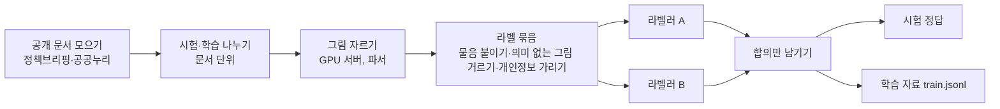

# 그림 해석 학습 자료 만들기 — 라벨링 기록

한국어 공공 문서 PDF 파서(kor_doc_parser)의 그림 해석 모델(SK텔레콤 A.X-4.0-VL-Light, 7.7B, Apache-2.0)을 튜닝하기 위해 **(그림, 물음, 정답)** 학습·시험 자료를 만든 과정이다. 계획과 결정은 `기획서.md` 7.10·D20, 수치의 원자료는 아래 '자료 위치'에 있다. 기록일 2026-10-20(진행 중 — 학습 문서 라벨링 중).

## 1. 왜 필요했나

- 파서의 그림 설명(D19)은 그림 속 **글자는 잘 읽지만** "어디가 가장 높은지·무엇이 가장 큰지·흐름이 어떤지" 같은 **해석**을 거의 하지 못했다. 같은 물음을 따로 물어도 정답률이 20~43%에 그쳤다(`테스트_결과.md` 11장).
- 모델은 그대로 두고 그 능력을 지도 학습(LoRA)으로 더하기로 했다. 그러려면 정답이 달린 그림이 필요하다.

## 2. 자료 두 갈래

| | 합성 그림 | 실제 문서 그림 |
|---|---|---|
| 출처 | 코드(matplotlib)로 그린 그래프·지도·흐름도·조직도 | 공개 정부 문서 PDF 에서 파서가 잘라 낸 그림 |
| 정답 | 그린 값·연결에서 **코드가 계산**(틀릴 수 없음) | **Claude 라벨러 둘이 따로** 매기고 둘이 같은 것만 |
| 규모 | 3,000장 · 물음 8,532개(그래프 1,000·지도 1,000·흐름도 500·조직도 500), CPU 6분 | 33개 문서 — 시험 6 · 학습 27 |
| 역할 | 해석의 기본기(많은 정답) | 실제 문서의 모양에 익숙하게 + **시험지는 실제 그림으로만** |

이 기록은 실제 문서 그림의 라벨링을 다룬다.

## 3. 전체 흐름

## 4. 단계별로

### 4.1 문서 모으기
- 출처: 정책브리핑(korea.kr) 보도자료 첨부 PDF. **공공누리 제1유형(출처표시) 또는 자유이용** 표시가 있는 공개 문서만 쓴다. 받은 문서의 출처 링크와 받지 않은 후보·까닭을 파일로 남겼다.
- 시험용(6개)은 깐깐하게 골랐다 — 기관 6곳에서 하나씩, 그래프·지도·도식이 고루, 출처 페이지의 공공누리 표시 확인(4개는 PDF 안 마크까지).
- 학습용(27개)은 처음 기준(PDF 안 마크까지, 2025~26, 6~40쪽, 도식 3개 이상, 기관당 2개)이 너무 빡빡해 에이전트 둘이 한 시간 넘게 돌아 8개만 받았다. 그래서 **넓혔다** — 출처 페이지 표시만, 2023~2026, 4~80쪽, 그림 3개 이상, 기관당 4개. 이미 받아 분석해 둔 후보 1,845개에서 스크립트로 골라 새로 찾는 비용을 줄였다.
- 늘 지킨 것: 개인 명단·사람 이름이 든 조직도·제목에 사람 이름이 든 문서 제외, 스캔본·HWP 만 있는 것 제외, 평가 문서와 같은 연속 보도 제외.

### 4.2 시험·학습 나누기
- **문서 단위**로 나눴다(같은 문서의 그림이 시험과 학습에 갈리지 않게). 학습 묶음을 만드는 코드가 시험 문서 목록(sha256·파일 이름)을 읽어 학습 자료에서 자동으로 뺀다.

### 4.3 그림 자르기
- 파서가 쪽을 그림으로 그리고, 쪽 배치 모델(PP-DocLayoutV3)이 그림 자리(bbox)를 찾아 PNG 로 잘라 낸다. 그림 속 글자는 PaddleOCR-VL-1.6 이 읽고, 그림 제목·앞뒤 본문은 PDF 글자층에서 가져온다 — 실제 서비스에서 모델이 보는 것과 같은 입력이다.
- 학습 자료에는 표가 필요 없어 **'그림만' 파싱 설정**을 따로 만들었다(그림 밖 블록은 VLM 을 건너뛰고 글자층으로 채움). 기본 파싱 경로는 바꾸지 않았다.
- 처음에는 서버 비용을 아끼려고 CPU 에서 돌렸지만 그림 하나에 1~2분(문서 3개 동시면 메모리 부족)이라 멈췄다. **GPU 서버(A40)에서 33개 문서를 16분**에 잘랐다. 그 과정에서 한 문서가 제목 단계 조립 버그로 멈춰, 고치고 재현 시험을 더했다. 같은 서버에서 단위 시험 623개가 통과했다.

### 4.4 라벨 묶음 — 물음 붙이기
- 그림마다 같은 꼴의 물음을 붙인다(평가 물음과 글자까지 같다):

| 갈래 | 물음 | 답 꼴 |
|---|---|---|
| 지도 | 값이 가장 높은·낮은 곳은 지도의 어느 쪽인가 | 9방위 보기(지도 테두리를 3×3 으로 나눔) |
| 그래프 | 값이 가장 큰·작은 때나 항목 | 그림에 적힌 이름 그대로 |
| 그래프 | 전체 흐름 | 보기 5개(늘어남·줄어듦·늘다가 줄어듦·줄다가 늘어남·뚜렷한 흐름 없음) |
| 흐름도 | 처음·마지막 단계, 'X' 바로 다음 단계 | 상자 글 그대로 |
| 조직도 | 맨 위, 'X' 바로 위 | 상자 글 그대로 |

- 'X' 는 그림 속 글자에서 물음 번호로 정해 고른다 — 두 라벨러가 **같은 물음**을 받게.
- **의미 없는 그림 거르기**: 로고·엠블럼·아이콘·사진처럼 해석할 내용이 없는 그림은 묶지 않는다(쪽 넓이 3% 미만, 그림 속 글자 없음, 한 줄 짧은 글뿐 — 그래프·지도로 검출된 것은 늘 남김). 학습 묶음에서 73개, 시험 묶음에서 7개를 걸렀다.
- **개인정보 가리기**: 보도자료 끝 담당자 표·기관장 인용의 이름은 ○○○ 로, 전화번호는 지운다. 묶음마다 남은 이름·전화번호 꼴을 다시 세고, 직함에 붙여 쓴 이름 3곳을 추가로 가렸다. 라벨러 결과에도 이름을 쓰지 않게 했다.

### 4.5 라벨러 — 독립된 둘
- Claude 에이전트 둘(A·B, Opus)이 **서로의 답을 보지 않고** 같은 지시문(`data/label/figures.py` 의 `LABEL_GUIDE`)대로 매긴다. 그림을 직접 열어 보고, 작은 글씨·막대 위 숫자는 잘라 확대한 사본으로 확인한다.
- 물음마다 `ok_question`(이 그림에 맞는 물음인가)·`answer`·`note`(한 줄 근거)를 적는다. 그래프에 지도 물음, 구성비 그래프에 흐름 물음처럼 맞지 않는 물음은 뺀다.
- 한 라벨러가 보는 그림을 15~18개로 나눴다(묶음을 몫으로 쪼개 여러 라벨러가 동시에) — 대화가 길어지면 비용이 크게 늘기 때문이다.

### 4.6 합의만 남기기
- 둘 다 '맞는 물음'이라 하고 정답도 같은 것만 쓴다.
  - 보기 물음은 둘 다 **보기 하나**만 적었고 그것이 같을 때만 — 정답이 여럿이면 맞는 다른 보기를 틀렸다고 가르치게 되므로 뺀다.
  - 단답은 띄어쓰기·따옴표·물결/줄표를 맞춘 뒤 비교하되, **숫자 덩어리를 자르는 맞춤은 막는다**('3주차' ≠ '13주차', '1.5' ≠ '15').
- 이 규칙들은 독립 코드 검토(지적 27건)에서 나온 것이다 — 처음에는 두 평가자 정답의 합집합을 썼고 숫자 앞자리를 가리지 못했다.

## 5. 결과(2026-10-20)

**시험 자료(문서 6개)**

| 묶음 | 그림 | 물음 | 합의된 정답 | 정답 다툼 |
|---|---|---|---|---|
| 문서 2개 | 31 | 160 | 57 | 0 |
| 문서 4개 | 53 | 378 | 83 | 0 |
| 합계 | 84 | 538 | **140**(그래프 120 · 지도 11 · 흐름도·조직도 9) | **0** |

- 둘 다 '맞는 물음'이라고 본 것 가운데 정답이 서로 다른 경우는 한 번도 없었다. 갈린 것은 '이 물음이 그림에 맞는가'(한쪽만 맞다고 본 물음 29개)였다.
- 기존 시험 67개(문서 4개)와 합쳐 시험 정답 207개.

**학습 자료(문서 27개)** — 라벨링 중: 그림 396개 · 물음 2,522개를 18개씩 22몫으로 나눠 세 차례에 걸쳐 진행.

## 6. 비용과 시간

| 일 | 시간 | 규모 |
|---|---|---|
| 그림 자르기(GPU A40) | 16분 + 환경 설치 7분 | 문서 33개 |
| 시험 라벨링(문서 2개) | 15분 | 라벨러 4명 · 약 63만 토큰 |
| 시험 라벨링(문서 4개) | 28분 | 라벨러 6명 · 약 132만 토큰 |
| 합성 그림 | 6분(CPU) | 3,000장 |

그림 하나(라벨러 둘)에 약 2만~2.5만 토큰이 들었다. 사용량 상한을 정해 두고 차례마다 확인하며 진행했다.

## 7. 배운 점

- **시험지와 학습 자료의 기준을 나눈다** — 시험지는 깐깐하게(근거가 분명한 문서·고른 갈래), 학습 자료는 넓게(양·다양성). 한 기준으로 둘 다 하려다 모으기가 멈췄다.
- **무거운 전처리는 GPU 에서 몰아서** — CPU 로 그림 하나에 1~2분이던 일이 GPU 에서 문서 하나에 수십 초였다. 서버는 자르기만 하고 끄고, 라벨링은 로컬에서.
- **정답이 여럿인 보기 물음은 학습에서 뺀다** — 하나를 고르면 다른 정답을 틀렸다고 가르친다.
- **독립 라벨러 둘의 합의는 정답보다 '물음이 맞는가'에서 갈린다** — 정답 다툼은 0, 물음 적합성 판단만 갈렸다.
- **같은 모델 계열이 학습·시험 정답을 함께 매기면 점수가 부풀 수 있다** — 그래서 시험지는 문서 단위로 떼어 두고, 한쪽만 맞다고 본 물음과 무작위 표본을 사람이 확인하는 표로 낼 예정이다.

## 8. 자료 위치

| 무엇 | 위치 |
|---|---|
| 시험·학습 문서 목록(출처·공공누리 근거) | `eval/testset/docs.jsonl` · `data/label/docs.jsonl` |
| 물음 틀·정답 맞춤 | `src/kdp/figure_qa.py` |
| 라벨 묶음·라벨러 지시문·합의 | `data/label/figures.py`(pack · merge · `LABEL_GUIDE`) |
| 합성 생성기 | `data/synth/figures.py` |
| 서버 그림 자르기 | `gpu_server/crop_tt.sh` · `configs/parse/figures_only.yaml` |
| PDF·잘린 그림·라벨(저장소 밖) | `/hdd_data/raganything/tt_dt`(시험) · `/hdd_data/raganything/tt_dt/tr_dt`(학습) |
